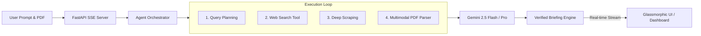

<div align="center">

# 🧠 OmniBrief
### Autonomous Multimodal Research Agent & Executive Briefing Generator

[](https://www.python.org/)
[](https://fastapi.tiangolo.com/)
[](https://ai.google.dev/)
[](https://www.docker.com/)
[](https://opensource.org/licenses/MIT)

**OmniBrief** is an autonomous intelligence agent that conducts deep, multi-step research across live web sources and user-uploaded reference documents, streaming its real-time reasoning trace directly to a glassmorphic dashboard before synthesizing publication-ready executive briefings with verified citations.

[Features](#-key-features) • [Architecture](#-architecture) • [Quickstart](#-quickstart) • [License](#-license)

</div>

---

## ⚡ Key Features

- 🔄 **Real-Time Agent Thought Stream (SSE):** Watch the agent formulate hypotheses, spawn targeted web searches, scrape web articles, and cross-reference citations in real time.
- 📄 **Multimodal Document RAG:** Drop research PDFs, whitepapers, or quarterly reports alongside your prompt to ground the research in your proprietary context.
- 🌐 **Autonomous Web Gathering:** Leverages concurrent search tools and automated HTML scraper pipelines to pull live sources and data metrics.
- 📑 **Publication-Ready Export:** Generates formatted markdown briefings featuring executive summaries, SWOT analysis, structured data tables, and print-ready PDF styling.
- 🛡️ **Offline & Online Resilience:** Seamlessly uses Gemini 2.5 Flash / Pro when configured, with built-in structured fallback synthesis for zero-friction local evaluations.

---

## 🏗️ Architecture



---

## 🚀 Quickstart

### Option 1: Docker (Recommended)

```bash
git clone https://github.com/Navaneeth1324/omnibrief.git
cd omnibrief

# Copy env and add your GEMINI_API_KEY
cp .env.example .env

# Run container
docker-compose up --build
```
Open **`http://localhost:8000`** in your browser.

---

### Option 2: Local Setup

1. **Clone & Virtual Environment:**
   ```bash
   git clone https://github.com/Navaneeth1324/omnibrief.git
   cd omnibrief
   python3 -m venv .venv
   source .venv/bin/activate
   pip install -r requirements.txt
   ```

2. **Configure Environment:**
   ```bash
   cp .env.example .env
   # Add your key to .env:
   # GEMINI_API_KEY=your_key_here
   ```

3. **Run Application:**
   ```bash
   uvicorn omnibrief.api.server:app --reload --port 8000
   ```
   Navigate to **`http://localhost:8000`**.

4. **Run Tests:**
   ```bash
   pytest -v tests/
   ```

---

## 📜 License
Distributed under the MIT License. See `LICENSE` for more information.
